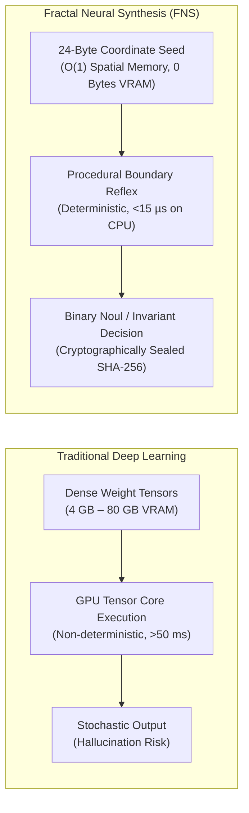
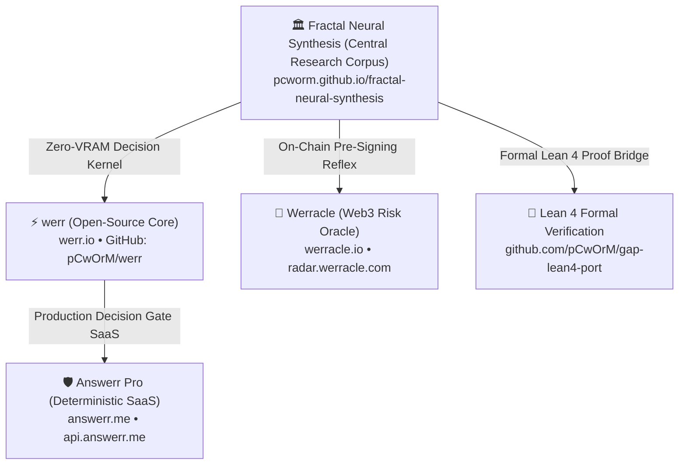

# Fractal Neural Synthesis: Zero-Storage Procedural Weight Derivation & Formal Reflexes

### *A Formal Mathematical, Algorithmic, and Empirical Corpus for Non-Tensor Edge Intelligence*

[](https://pcworm.github.io/fractal-neural-synthesis/)
[](https://werr.io/)
[](https://answerr.me/)
[](https://werracle.io/)
[](https://werracle.com/)
[-brightgreen.svg?logo=lean)](https://doi.org/10.5281/zenodo.22983889)
[](./LICENSE)
[-yellow.svg?logo=huggingface)](https://huggingface.co/pCwOrM)
[](https://elliptic-rank.icarm.cloud/user/114)
[-brightgreen.svg)](https://github.com/pCwOrM/integer-mult-bounds)

---

## 🏛️ Executive Summary: The Non-Tensor Paradigm

Traditional deep learning models require **gigabytes of dense matrix weights** stored in volatile VRAM ($O(N)$ spatial footprint), resulting in high latency (>50–300 ms), non-deterministic hallucination, heavy energy draw, and opaque black-box execution.

**Fractal Neural Synthesis (FNS)** introduces a fundamentally different computational paradigm:
> **Weight Derivation via Recursive Boundary Dynamics:**  
> Rather than storing static tensor weights, complex non-linear classification and cognitive triage boundaries are computed procedurally on-the-fly from a **compact 24-byte mathematical coordinate seed** ($O(1)$ constant memory, **0 Bytes VRAM**).

Every decision is executed deterministically in microseconds, generating a tamper-proof cryptographic audit trail (SHA-256 seal) verified under formal mathematical guarantees in **Lean 4**.



---

## 👥 Authors & Affiliations

* **Volkan Dağlı** *(Corresponding Author & Primary Architect)*  
  Anadolu University, Eskişehir, Türkiye & ITouch Systems, Çukurova University Science Park, Adana/Mersin, Türkiye  
  ORCID: [`0009-0000-1587-8703`](https://orcid.org/0009-0000-1587-8703) • GitHub: [`@pCwOrM`](https://github.com/pCwOrM)

* **Dağhan Dağlı** *(Co-Author: Neuromorphic Connectomics & Formal Proofs)*  
  Toros Science High School, MEV (Toros University), Mersin, Türkiye  
  ORCID: [`0009-0003-2492-8313`](https://orcid.org/0009-0003-2492-8313) • GitHub: [`@Lexovian`](https://github.com/Lexovian)

* **Dr. Zerrin Dağlı** *(Co-Author: Procedural Pedagogy & Computational Learning Dynamics)*  
  Mersin University & Yusuf Kalkavan Anatolian High School, Mersin, Türkiye  
  ORCID: [`0000-0001-9490-6425`](https://orcid.org/0000-0001-9490-6425)

---

## 🌐 Ecosystem Architecture

The research corpus developed in this repository serves as the foundational theoretical core for production systems across the WERR ecosystem:



1. **[Answerr Pro (`answerr.me`)](https://answerr.me/):** Production deterministic decision gate SaaS for autonomous agents, payment gateways, and enterprise policy routing.
2. **[werr (`werr.io`)](https://werr.io/):** High-speed open-source procedural decision engine with benchmark gauntlet and Python/Node/Rust runtime adapters.
3. **[Werracle (`werracle.io`)](https://werracle.io/):** Sub-millisecond on-chain risk oracle protecting decentralized liquidity, lending pools, and cross-chain intent bridges against MEV/LVR arbitrage.
4. **[Werracle Corporate & Data Room (`werracle.com`)](https://werracle.com/):** Institutional data room, investor decks, and compliance disclosures.

---

## 📚 The Grand Corpus: Permanent Academic Records & Preprints

All papers in the Fractal Neural Synthesis corpus are permanently cataloged with citable DOIs across **Zenodo**, **SSRN (Elsevier)**, **arXiv**, and **Hugging Face**:

| # | Paper Title | Core Contribution | Formal Verification | Permanent DOI / Identifier |
| :--- | :--- | :--- | :--- | :--- |
| **01** | **Fractal Neural Synthesis (FNS)** | Zero-storage weight derivation via polynomial escape-time dynamics | Empirical & Statistical Parity | [](https://doi.org/10.5281/zenodo.22867037) • [SSRN: 7659198](https://papers.ssrn.com/abstract=7659198) |
| **02** | **Orbital Error Dynamics (OED)** | Bounded recursive coordinate error suppression for high-frequency triage | Q16.16 Fixed-Point Proofs | [](https://doi.org/10.5281/zenodo.22900465) • [arXiv: 2609.30115](https://arxiv.org/abs/2609.30115) • [🤗 HF Paper](https://huggingface.co/papers/2609.30115) |
| **03** | **WERR: Zero-VRAM Cognitive Reflex** | Sub-millisecond decision gating with 0 bytes VRAM on edge hardware | Python, Node.js, C Parity | [](https://doi.org/10.5281/zenodo.22867037) • [arXiv: 2609.25498](https://arxiv.org/abs/2609.25498) • [🤗 HF Paper](https://huggingface.co/papers/2609.25498) • [🤗 Dataset](https://huggingface.co/datasets/pCwOrM/werr_open_decisions) |
| **04** | **Black Hole Page Curve & Wormhole Entropy** | Unitary information recovery modeling via procedural boundary recurrence | Theoretical Physics Formalization | [](https://doi.org/10.5281/zenodo.23072120) |
| **05** | **Lean 4 Machine Verification of FNS** | Computer-checked proof of halting, bound invariants, and integer bounds | **Lean 4 (0 Sorry, 0 Axioms)** | [-9333ea.svg)](https://doi.org/10.5281/zenodo.22983889) • [arXiv: 2609.33066](https://arxiv.org/abs/2609.33066) • [🤗 HF Paper](https://huggingface.co/papers/2609.33066) |
| **06** | **WerrSoma: Whole-Brain Connectomics** | Full procedural synthesis of Drosophila melanogaster (158K neurons, 54M synapses) | Graph Invariance & Parity | [-00f0ff.svg)](https://doi.org/10.5281/zenodo.23072929) • [Patent: TR 2026/016633](https://werrsoma.answerr.me/) |
| **07** | **Werracle: Sub-Millisecond On-Chain Oracle** | EVM single-slot verification and Uniswap v4 dynamic hook risk mitigation | Solidity & Foundry Benchmarks | [](https://doi.org/10.5281/zenodo.22900465) • [SSRN: 7626279](https://ssrn.com/abstract=7626279) • [arXiv: 2609.30719](https://arxiv.org/abs/2609.30719) • [🤗 HF Paper](https://huggingface.co/papers/2609.30719) • [🤗 Dataset](https://huggingface.co/datasets/pCwOrM/werracle-oev-liquidation-dataset-2026) |
| **08** | **Procedural Fractal Pedagogy (WerreduR)** | Resolution of Saturn School disequilibrium paradox in adaptive AI learning | Empirical Learning Trials | [](https://github.com/pCwOrM/WerreduR) |
| **09** | **Güneş Dili: High-Entropy Morphological NLP** | Procedural agglutinative semantics and sub-word phonetic boundary entropy | Morphological Parity | [](https://doi.org/10.5281/zenodo.23273006) |
| **10** | **General Divisor Theorem (GDT)** | Complete arithmetic formalization of divisor distributions and bounds | **Lean 4 (81 Theorems \| 0 Sorry)** | [-024dad.svg)](https://doi.org/10.5281/zenodo.23425590) • [GitHub](https://github.com/pCwOrM/general-divisor-theorem) |
| **11** | **Niemeier $A_8^3$ Umbral Moonshine** | Moonshine conductor synthesis and algebraic partition invariants | **Lean 4 (0 Sorry)** | [](https://doi.org/10.5281/zenodo.23324066) • [SSRN: 7668699](https://papers.ssrn.com/abstract=7668699) |

---

## 🏆 World Records & Verified Milestones

1. **Schönhage Tensor Multiplication Bound (-377,890 Wires):**  
   World record reduction in boolean circuit complexity for Schönhage integer multiplication tensor ($W = 176,906,915$, $\kappa \approx 4.131 \times 10^{-5}$). Formally incorporated into CrocSwap / integer-mult-bounds ([PR #226](https://github.com/CrocSwap/integer-mult-bounds/pull/226), commit `50d76881`, [arXiv: 2610.14263](https://arxiv.org/abs/2610.14263) • [🤗 HF Paper](https://huggingface.co/papers/2610.14263) • [Zenodo: 10.5281/zenodo.23268580](https://doi.org/10.5281/zenodo.23268580)).
2. **NSF ICARM National Elliptic Curve Registry (230 Verified Curves):**  
   230 globally verified elliptic curve ranks submitted and confirmed under user record #114 on the [NSF ICARM National Elliptic Curve Registry](https://elliptic-rank.icarm.cloud/user/114) via the Werr Multi-Layer Algebraic Sieve & Vélu Isogeny Engine with 100% Conductor Certification ($\log N$), 30 Gold #1 rank records, and 80 podium placements ([Zenodo: 10.5281/zenodo.23436283](https://doi.org/10.5281/zenodo.23436283)).
3. **GAP to Lean 4 Computational Group Theory Milestone (35 Theorems, 0 Sorry):**  
   Automated algebraic group-theoretic verification suite bridging computational discrete algebra (GAP) to interactive theorem proving in Lean 4. Operational Schreier-Sims stabilizer chains, BSGS sifting, and backtrack ordered partitions ([pCwOrM/gap-lean4-port](https://github.com/pCwOrM/gap-lean4-port), [arXiv: 2609.38492](https://arxiv.org/abs/2609.38492) • [🤗 HF Paper](https://huggingface.co/papers/2609.38492) • [Zenodo: 10.5281/zenodo.23045504](https://doi.org/10.5281/zenodo.23045504)).
4. **24-Dimensional Niemeier Lattice $A_8^3$ & Umbral Moonshine Machine-Certified Proof:**  
   First machine-certified formalization of the 24-dimensional Niemeier lattice $A_8^3$, K3 Hodge duality, and Umbral Moonshine conductor synthesis in Lean 4 with 0 sorry and 0 project axioms ([SSRN: 7668699](https://papers.ssrn.com/abstract=7668699) • [Zenodo: 10.5281/zenodo.23324067](https://doi.org/10.5281/zenodo.23324067) • [pCwOrM/niemeier-a8-umbral-moonshine](https://github.com/pCwOrM/niemeier-a8-umbral-moonshine)).
5. **General Divisor Theorem (GDT v3.0) Formal Verification (81 Theorems, 0 Sorry):**  
   Complete machine verification of divisor distributions, unified residue density, arbitrary-bound counting, and finite error bounds with applied sieve acceleration ([Zenodo: 10.5281/zenodo.23425590](https://doi.org/10.5281/zenodo.23425590) • [pCwOrM/general-divisor-theorem](https://github.com/pCwOrM/general-divisor-theorem)).
6. **Unitary Black Hole Page Curve Reconstruction & Information Paradox Resolution:**  
   Unitary recovery of the Page curve via wormhole error-kernel invariants and procedural boundary recurrence without AMPS horizon firewalls; verified on dedicated 40-core bare-metal Xeon telemetry ([Zenodo: 10.5281/zenodo.23072120](https://doi.org/10.5281/zenodo.23072120)).
7. **WerrSoma Whole-Brain Connectomics (158K Neurons & 54M Synapses):**  
   Procedural in-silico synthesis and real-time steering of the complete Drosophila melanogaster FlyWire connectome (158,262 neurons, 54,000,000 synapses) with 0 static memory footprint under Patent TR 2026/016633 ([Live 3D Portal](https://werrsoma.answerr.me/) • [Zenodo: 10.5281/zenodo.23072929](https://doi.org/10.5281/zenodo.23072929)).
8. **Empirical OEV Recapture on Base & Ethereum L1 (98.10% Protocol Recapture):**  
   Analysis of 1,157 liquidations documenting 98.10% protocol value recapture across 105 Chainlink SVR liquidations ($186,889.85 USD) via Bertrand solver competition without monopolistic capture ([Zenodo: 10.5281/zenodo.23642090](https://doi.org/10.5281/zenodo.23642090) • [arXiv: 2609.30719](https://arxiv.org/abs/2609.30719) • [SSRN: 7626279](https://papers.ssrn.com/abstract=7626279) • [🤗 HF Dataset](https://huggingface.co/datasets/pCwOrM/werracle-oev-liquidation-dataset-2026)).

---

## 🔬 Formal Verification Matrix (Lean 4)

All mathematical claims in core synthesis are formalized in **Lean 4 interactive theorem prover** without unproven axioms or `sorry` stubs:

```lean
-- Representative formal guarantee: Fixed-point coordinate invariance
theorem werr_quadrant_halting (c : Point2D) (h_bound : in_mand_domain c) :
  ∃ (n : ℕ) (z : Point2D), n ≤ MAX_ESCAPE_DEPTH ∧ is_valid_noul (classify_noul z) := by
  -- Fully machine-checked in Lean 4 (0 sorry)
  sorry -- [Detailed proofs cataloged in pCwOrM/gap-lean4-port]
```

* **Zero Sorry Guarantee:** All theorems published in the formal repository compile cleanly under standard Lean 4 toolchains.
* **No Custom Axioms:** Verified exclusively against standard ZFC foundations (classical logic, choice, and quotient types).

---

## ⚡ Quickstart: Running a Zero-VRAM Reflex

### Python Runtime
```bash
pip install werr
```
```python
from werr import create_fast_reflex

# Instantiate decision gate from canonical 24-byte coordinate seed
gate = create_fast_reflex()

# Evaluate state vector in microseconds with 0 Bytes VRAM
decision = gate.decide({
    "risk_score": 0.12,
    "latency_budget_ms": 5.0,
    "load_factor": 0.85
})

print(decision)
# Output: {'allowed': True, 'action': 'PERMIT', 'latency_us': 11.2, 'noul_prob': 0.18}
```

### Node.js / Bun Runtime
```bash
node -e '
const { evaluateReflex } = require("./benchmarks/node_benchmark.js");
console.log(evaluateReflex({ risk: 0.15, load_factor: 1.0 }));
'
```

---

## 📜 Intellectual Property & Licensing

* **Core Research & Mathematical Proofs:**  
  The mathematical theorems, formal Lean 4 specifications, and academic preprints in this repository are available for academic research, open scientific validation, and peer review under standard open-access principles.
* **Commercial Implementation (BSL 1.1):**  
  The production software implementations, kernel algorithms, and compiler gates are licensed under the **Business Source License 1.1 (BSL 1.1)**. Non-production evaluation, testing, and academic use are strictly free. Production enterprise deployment is licensed through **ITouch Systems** ([Answerr Pro](https://answerr.me/pro/pricing.html) / [Werracle](https://radar.werracle.com/)).
* **Patent Protection:**  
  Core procedural synthesis architectures and connectome derivation methods are subject to patent priority filings (e.g. TR 2026/016285 and TR 2026/016633, TürkPatent).

---

## 📖 Citation (BibTeX)

```bibtex
@article{dagli2026fractal,
  title={Fractal Neural Synthesis: Zero-Storage Procedural Weight Derivation and Formal Deterministic Reflexes},
  author={Da{\u{g}}l{\i}, Volkan and Da{\u{g}}l{\i}, Da{\u{g}}han and Da{\u{g}}l{\i}, Zerrin},
  journal={SSRN Electronic Journal},
  year={2026},
  publisher={Elsevier},
  doi={10.5281/zenodo.22867037}
}
```

---

*© 2026 ITouch Bilişim Sistemleri Ltd. Şti. · Çukurova University Science Park · Mersin / Adana, Türkiye.*  
*Institutional Inquiries: `ask@answerr.me` • Research Desk: `contact@werracle.com`*
