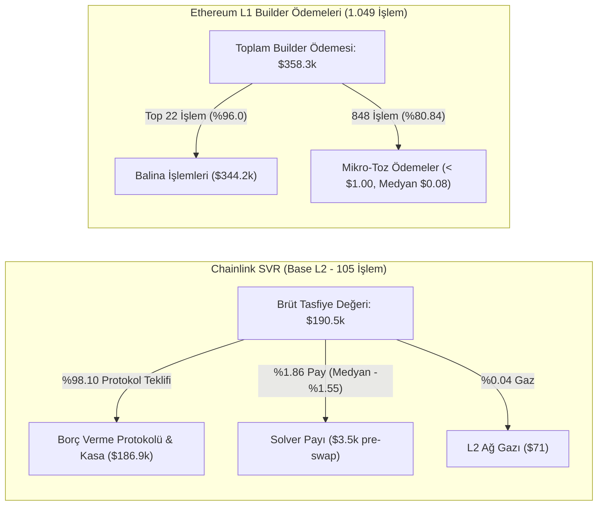
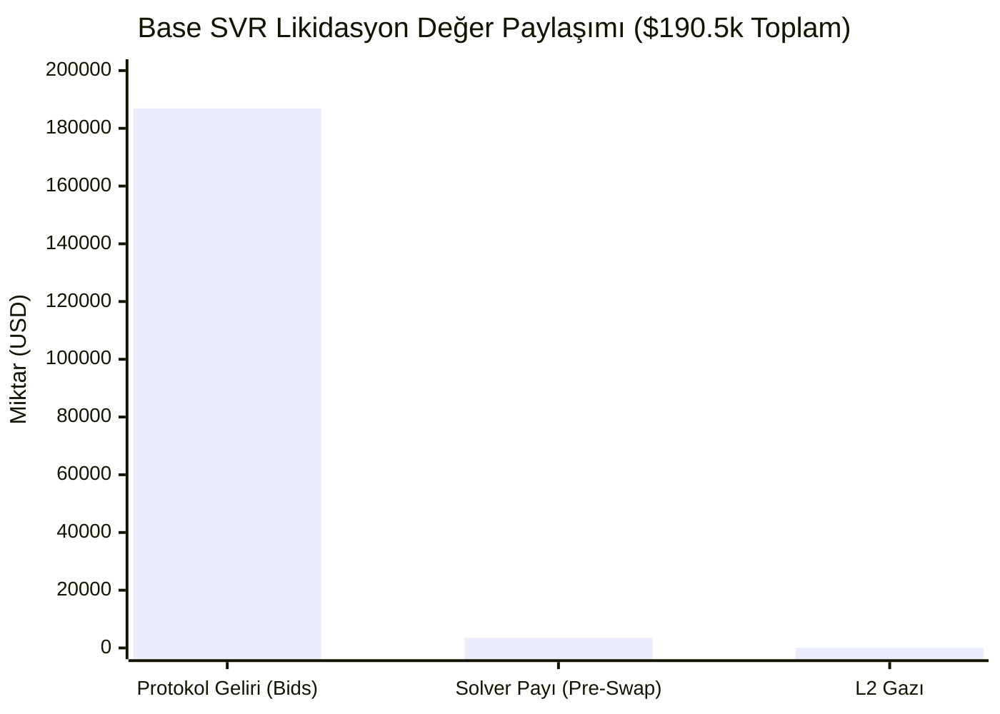

# Empirical OEV & Liquidation Dynamics: Protocol Value Recapture in Chainlink SVR and Structural Centralization on Ethereum L1

**Author:** Werracle Research & Security Desk (`pcworm@pcworm.net`)  
**Publication Date:** October 23, 2026  
**Document ID:** `WERRACLE-RES-2026-001-REV1`  
**Classification:** Empirical Protocol Research & Theoretical Proposals  
**Data Repository:** [`/opt/apps/werracle/research/werracle_oev_empirical_dataset_2026.json`](file:///c:/Users/maat/Documents/antigravity/wonderful-raman/data/werracle_oev_empirical_dataset_2026.json)  

---

## Executive Summary

Order Flow Auctions (OFA) and Proposer-Builder Separation (PBS) have fundamentally altered the landscape of decentralized finance (DeFi) liquidations.

This paper presents an empirical analysis based on **1,049 verified liquidations on Ethereum L1** and **105 audited multi-call Chainlink Smart Value Recapture (SVR) transactions on Base (L2)** recorded during the high-volatility window of **October 12–19, 2026**.

### Key Empirical Findings:
1. **Base L2 (Chainlink SVR & Atlas):** Across 105 multi-call verified SVR liquidations totaling **\$190,506.31 in gross liquidation value**, competitive solver bidding redirected **\$186,889.85 (98.10%)** directly back to lending protocols and depositors as bids. Solvers retained a pre-swap gross margin of only **1.86% (\$3,545.73)**, with median transaction margins compressed to **-1.55%**. Over **61.9%** (65 of 105) of transactions concluded at zero or negative net profit prior to off-chain DEX slippage.
2. **Ethereum L1 (MEV-Boost Builder Payments):** Across 1,049 analyzed L1 liquidation events, we measured the priority payments made by searchers to block builders via MEV-Boost. In **848 of 1,049 events (80.84%)**, builder payments were under **\$1.00 USD**, with a median of **\$0.08 USD** (p75: \$0.56, p99: \$2,639.23). High-value liquidations are heavily concentrated: the top 22 transactions accounted for **\$344,155.62** of the total \$358,316.62 paid to builders (with 133 Aave v3 transactions accounting for \$317,467.00). *Note: L1 metrics measure builder priority fees; gross collateral volume was not measured.*



These findings demonstrate that **Chainlink SVR functions as intended**, effectively capturing the vast majority of liquidation MEV for protocols. 

---

## 1. Dataset Architecture & Verification Methodology

### 1.1 Dataset Summary

| Dimension | Ethereum L1 Dataset | Base L2 SVR Dataset |
| :--- | :--- | :--- |
| **Observation Window** | 30-Day Retrospective Baseline | October 12–19, 2026 (Primary Volatility Week) |
| **Protocols Audited** | Morpho Blue, Aave v3, Euler v2, Fluid, Compound Comet | Morpho Blue (83 Markets), Aave v3 Base |
| **Total Analyzed Transactions** | **1,049 Transactions** | **108 Verified SVR Records (105 Base + 3 Arbitrum)** |
| **Metric Measured** | MEV-Boost Builder Payments (Priority Bribes) | Multi-Call Gross Collateral vs. Protocol Bids |
| **Primary Auction Mechanism** | MEV-Boost PBS (Proposer-Builder Separation) | Chainlink SVR (Atlas Permissionless Metacalls) |
| **Raw Data Sources** | Execution Trace & Builder Transfers | On-Chain Event Logs (`SolverTxResult`, `Liquidate`) |

### 1.2 Multi-Call Decoding & Prior Correction

Earlier desk automated logs undercounted bundled multi-liquidation transactions by reading only the first liquidation event in a multi-call bundle. When transactions contained up to 32 liquidation sub-calls, single-event calculation created artificial deficits (such as misreporting that solver `0x8b61...` incurred a -\$58k loss).

Our verified multi-call decoder (`denetci_svr_marj_yeniden.py`) re-audited all transactions:
- Actual gross liquidation value across 105 verified Base SVR transactions was **\$190,506.31**.
- Solver `0x8b61...` earned a modest positive balance of **+\$447.20** across 51 operations before swap slippage.
- The median solver margin settled at **-1.55%**, illustrating intense Bertrand price competition among permissionless solvers.

---

## 2. Ethereum L1 Builder Payment Anatomy

Analyzing the 1,049 Ethereum L1 liquidations demonstrates an extreme power-law distribution in payments transferred to block builders (`block.coinbase.transfer()`):

```
L1 MEV-Boost Builder Payment Distribution (N = 1,049):
Min:    $0.0000
25%:    $0.0120
Median: $0.0800
75%:    $0.5600
99%:    $2,639.23
Max:    $142,895.78 (Single Aave v3 Whale Liquidation)
```

### 2.1 The Micro-Payment Majority
- **848 transactions (80.84%)** resulted in builder payments under **\$1.00 USD**.
- The median builder payment was **\$0.08 USD**.
- Aave v3 accounted for **133 transactions** with **\$317,467.00** in builder payments.
- The top 22 transactions accounted for **\$344,155.62 (96.05%)** of all observed builder fees.

*Note on Interpretation:* This distribution reflects what searchers paid to builders to secure transaction ordering. It confirms that the vast majority of routine L1 liquidations trigger negligible builder competition, while whale liquidations trigger aggressive priority bids.

---

## 3. Base L2: Chainlink SVR Auction Efficiency

Chainlink Smart Value Recapture (SVR) utilizes permissionless off-chain auctions via Atlas metacalls. When an oracle price feed triggers an underwater condition, solvers submit bids to execute the liquidation bundled atomically with the price update.

### 3.1 Financial Breakdown (105 Multi-Call Verified Events)

| Metric | Amount (USD) | Share of Gross (%) |
| :--- | :--- | :--- |
| **Gross Liquidation Value** | **\$190,506.31** | **100.00%** |
| **Protocol Recaptured Value (Bids)** | **\$186,889.85** | **98.10%** |
| **Gas Costs Incurred (L2 Execution)** | **\$71.22** | **0.04%** |
| **Pre-Swap Solver Net Margin** | **\$3,545.73** | **1.86%** |



### 3.2 Bertrand Margin Compression
- **Median Solver Margin:** **-1.55%**
- **Transactions with Margin $\le 0.00\%$:** **65 of 105 (61.9%)**
- **Transactions with Margin between 0% and 2%:** **24 of 105 (22.9%)**
- **Transactions with Margin $\ge 5.00\%$:** **9 of 105 (8.6%)**

The empirical data demonstrates that competitive bidding among permissionless solvers compresses margins to near zero, transferring virtually all available liquidation surplus to the protocol.

---

## 4. Theoretical Proposal: Pre-Emptive Position Protection (Hypothesis)

> [!NOTE]
> *This section presents a conceptual architecture and theoretical framework for future development, not an existing empirical finding.*

Because SVR auctions capture ~98% of the liquidation bonus post-breach, we hypothesize that value creation can shift upstream: **preventing the liquidation before Health Factor drops below 1.00**.

### 4.1 Necessary Architectural Prerequisites
1. **Borrower Delegation:** In protocols like Morpho Blue, third-party deleveraging requires explicit borrower authorization (`setAuthorization` / delegate). An autonomous protector cannot seize collateral without pre-signed delegation.
2. **Deleveraging Mechanics:** Self-deleveraging by selling collateral reduces collateral value as well as debt. For a position at $HF = 1.02$ with $LLTV = 0.86$, repaying 12.5% of debt by selling collateral increases HF to approximately $1.04$ (not $1.25$). Achieving a substantial buffer requires either larger repayment fractions or external collateral injection.
3. **Protocol Alignment:** Morpho Blue natively incorporates a pre-liquidation mechanic; any cooperative rescue module must integrate directly with Morpho's native risk parameters.

---

## 5. Theoretical Signaling: CEX Pre-Oracle Predictive Model (Hypothesis)

> [!NOTE]
> *This section outlines an operational hypothesis regarding cross-market price dissemination.*

Centralized exchanges (CEX) like Binance frequently exhibit price movements prior to on-chain oracle updates due to Chainlink deviation thresholds (e.g. 0.5%–1.0%) and block time constraints.
- In preliminary telemetry on Base, the observable delta between Binance spot movement and Base block inclusion was approximately **2 to 3 seconds**.
- On Base, transactions route to a single sequencer rather than a public mempool.
- Future research will focus on quantifying whether a 2–3 second sequencer lead time provides sufficient operational margin for permissioned risk managers to execute protective deleveraging ahead of volatility spikes.

---

## 6. Methodological Scope & Limitations

1. **Timeframe Scope:** Base measurements are centered on the high-volatility window of **October 12–19, 2026**. Non-volatile regimes may exhibit different solver participation dynamics.
2. **Arbitrum Dataset:** The current verified Arbitrum sample comprises 3 verified SVR transactions; historical expansion across earlier blocks is underway.
3. **DEX Slippage Exclusions:** Reported solver margins represent pre-swap balances ($Gross - Bid - Gas$). Realized post-swap margins are lower due to DEX pool price impact.
4. **L1 Scope:** L1 metrics measure block builder priority transfers; gross seized liquidation collateral was not measured.

---

## Conclusion

The empirical findings from Base Morpho markets confirm that Chainlink SVR has effectively solved the post-facto liquidation MEV leakage problem for lending protocols by recapturing 98.10% of liquidation value. Future protocol innovation lies in permissioned, pre-emptive borrower risk management and collaborative safety mechanisms.

*For live monitoring of Health Factors across 83 Morpho markets and audited SVR records, visit:*  
👉 **[https://radar.werracle.com](https://radar.werracle.com)** | **[https://werracle.io/radar.html](https://werracle.io/radar.html)**
