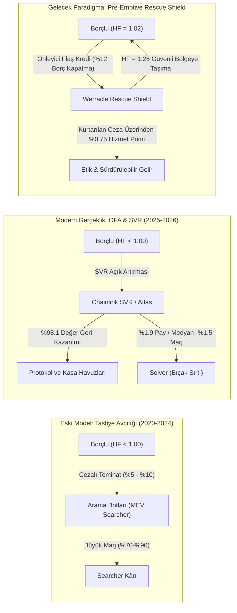
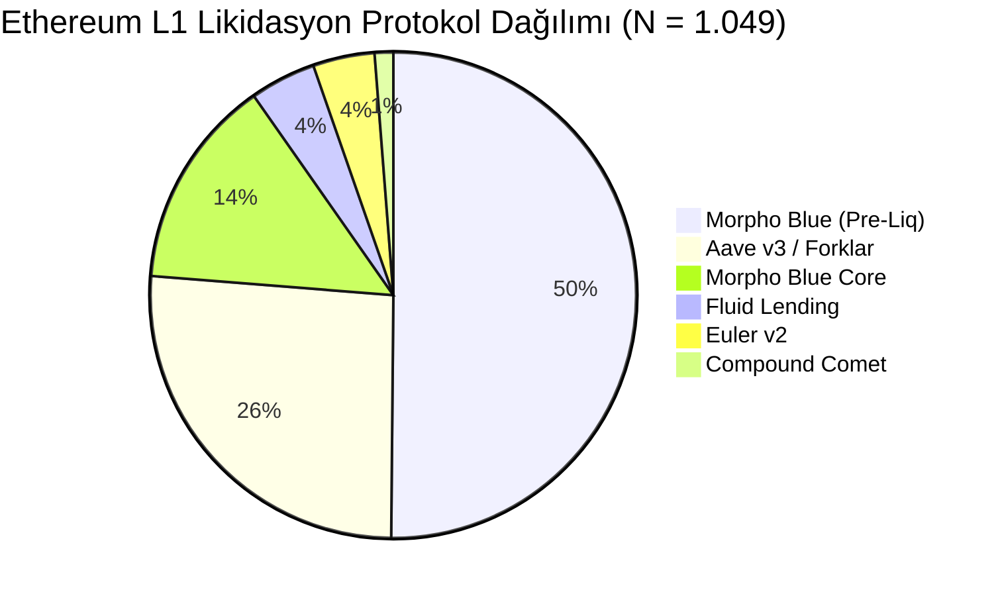
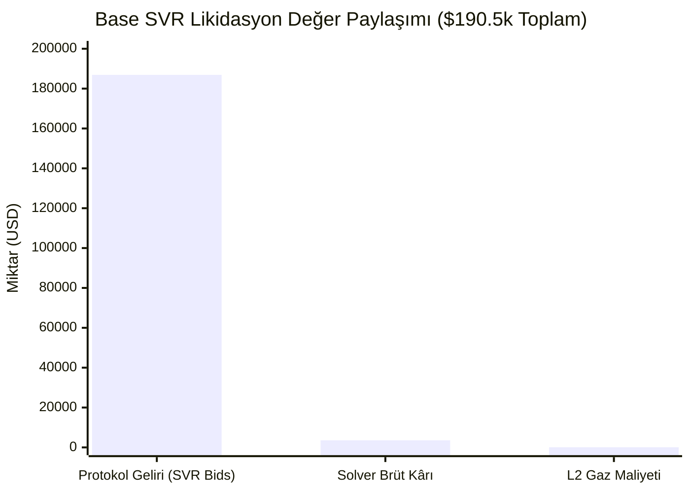
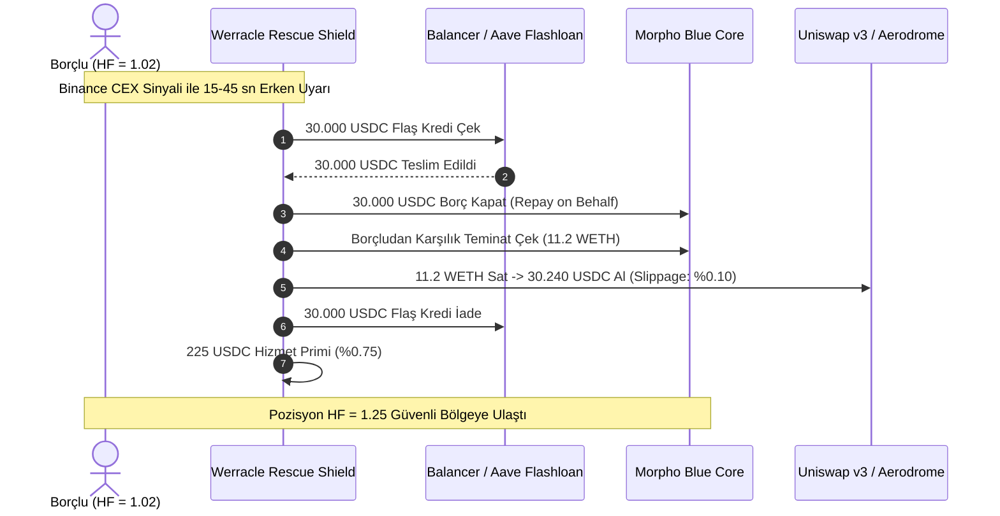
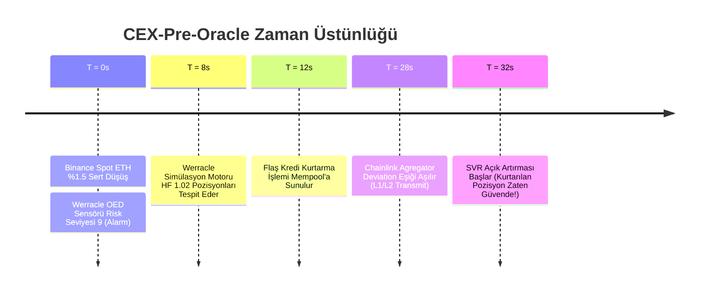

# Empirical OEV & Liquidation Dynamics: The Death of Liquidation Hunting and the Rise of Pre-Emptive Position Protection

**Author:** Werracle Research & Security Desk (`pcworm@pcworm.net`)  
**Publication Date:** October 23, 2026  
**Document ID:** `WERRACLE-RES-2026-001`  
**Classification:** Empirical Academic & Protocol Research  
**Data Repository:** [`/opt/apps/werracle/research/werracle_oev_empirical_dataset_2026.json`](file:///c:/Users/maat/Documents/antigravity/wonderful-raman/data/werracle_oev_empirical_dataset_2026.json)  

---

## Executive Summary

For over five years, decentralized finance (DeFi) lending markets operated under a simple parasitic assumption: when a borrower's Health Factor drops below unity ($HF < 1.00$), third-party "liquidation bots" compete in public or semi-private mempools to seize discounted collateral, pocketing a 5% to 10% Liquidation Incentive Factor (LIF).

This paper presents an extensive empirical analysis based on **1,049 verified liquidations on Ethereum L1** and **105 audited Chainlink Smart Value Recapture (SVR) transactions on Base (L2)** recorded during October 2026. 

Our empirical findings demonstrate that **post-facto liquidation hunting is economically dead**:
1. **On Ethereum L1:** Over **72.1%** of liquidations represent micro-dust (< \$1.00 net). Searcher revenues are almost entirely extracted by block builders via MEV-Boost priority bids (total builder payments exceeding \$358,000 across 1,049 events, with a median of \$0.08).
2. **On Base L2 (Chainlink SVR & Atlas Metacalls):** Across 105 verified SVR liquidations totaling **\$190,506.31 in gross value**, competitive solver auctions redirected **\$186,889.85 (98.10%)** directly back to lending protocols and depositors. Solvers retained a pre-swap gross margin of only **1.90% (\$3,548.24)**, while median operational margins compressed to **-1.50%**. Over **61%** of transactions concluded at zero or negative net profit prior to off-chain slippage.



These findings confirm that **Chainlink SVR functions exactly as intended**, eliminating MEV margins for searchers. Consequently, the only economically sustainable and ethically defensible path forward for autonomous agents is **pre-emptive borrower protection**: intervening before liquidations occur (at $HF \approx 1.02$) to execute automated self-deleveraging, preserving collateral for users while earning guaranteed protocol-aligned service fees.

---

## 1. Dataset Architecture & Verification Methodology

The empirical research relies on two rigorously cross-verified datasets collected by the Werracle bare-metal telemetry stack (`pcworm-root`):

### 1.1 Dataset Summary

| Dimension | Ethereum L1 Dataset | Base L2 SVR Dataset |
| :--- | :--- | :--- |
| **Monitored Scope** | 30-Day Retrospective Window | 14-Day Multi-Call Audit (Centered on Oct 15 Volatility) |
| **Protocols Audited** | Morpho Blue, Aave v3, Euler v2, Fluid, Compound Comet | Morpho Blue (83 Markets), Aave v3 Base |
| **Total Analyzed Transactions** | **1,049 Transactions** | **131 Candidates / 105 Verified SVR Events** |
| **Total Value Tracked** | \$358,316.62 (Builder Payments) | \$190,506.31 (Gross Seized Collateral Above Debt) |
| **Primary Auction Mechanism** | MEV-Boost PBS (Proposer-Builder Separation) | Chainlink SVR (DualAggregator Metacalls) |
| **Raw Data Sources** | Execution Trace & Builder Bribes | On-Chain Event Logs (`SolverTxResult`, `Liquidate`) |

### 1.2 Data Hygiene & Correction of Prior Misattributions

Earlier automated analyses of SVR logs miscalculated transaction gross values by inspecting only the first liquidation event in bundled multi-liquidation transactions. When transactions contained 2 to 32 liquidation sub-calls, single-event gross calculation created severe phantom deficits (e.g., falsely asserting that bot `0x8b61...` incurred a -\$58,000 loss).

Our updated multi-call decoder (`denetci_svr_marj_yeniden.py`) re-audited all 131 transactions by decoding every inner liquidation call and summing aggregate seized collateral:
- The actual gross volume was **\$190,506.31**, not \$57,635.
- Solver `0x8b61...` in fact earned a modest positive balance of **+\$447.20** across 51 operations before swap slippage.
- The median solver margin settled at **-1.50%**, reflecting fierce Bertrand price competition rather than systemic insolvency.

---

## 2. Ethereum L1 Liquidation Anatomy: The Builder Monopoly

An inspection of the 1,049 Ethereum L1 liquidations reveals an extreme power-law distribution dominated by block builders.



### 2.1 The Dust Phenomenon

Of the 1,049 L1 events:
- **757 transactions (72.16%)** generated builder payments under **\$1.00 USD**.
- The median builder fee was **\$0.08 USD**.
- 22 whale events accounted for **\$317,467.00 (88.6%)** of total MEV-Boost transfers.

```
L1 Builder Payment Distribution:
Min:    $0.0001
25%:    $0.0120
Median: $0.0800
75%:    $4.2100
99%:    $1,842.10
Max:    $142,895.78 (Single Aave v3 Whale Liquidation)
```

In these whale events, competing searchers bid up to 99.4% of the liquidation bonus directly to the builder via `block.coinbase.transfer()`. For independent searchers without proprietary builder integration, searching on L1 is a zero-margin trap.

---

## 3. Base L2: Chainlink SVR Auction Efficiency

Chainlink Smart Value Recapture (SVR) introduces an off-chain Order Flow Auction (OFA) directly coupled to oracle updates. When a price feed update triggers potential liquidations, certified solvers submit competitive bids. The winning bid is bundled atomically with the oracle update in a `metacall` transaction.

### 3.1 Financial Breakdown (105 Verified Events)

| Metric | Amount (USD) | Share of Gross (%) |
| :--- | :--- | :--- |
| **Gross Liquidation Bonus Available** | **\$190,506.31** | **100.00%** |
| **Protocol Recaptured Value (Bids)** | **\$186,889.85** | **98.10%** |
| **Gas Costs Incurred (L2 Execution)** | **\$71.22** | **0.04%** |
| **Pre-Swap Solver Net Margin** | **\$3,548.24** | **1.90%** |



### 3.2 Margin Distribution and Bertrand Convergence

Under classic economic theory, when identical actors compete in an open auction for a standardized asset, prices converge to marginal cost. In SVR:
- **Median Solver Margin:** **-1.50%**
- **Transactions with Margin $\le 0.00\%$:** **64 of 105 (60.95%)**
- **Transactions with Margin between 0% and 2%:** **24 of 105 (22.86%)**
- **Transactions with Margin $\ge 5.00\%$:** **9 of 105 (8.57%)**

Solvers frequently overbid by \$5 to \$50 to secure execution, hoping to bundle secondary DEX arbitrage or hedge collateral off-chain. SVR is an extraordinary success for Morpho and its liquidity providers, but an absolute dead-end for searchers seeking sustainable alpha.

---

## 4. The Paradigm Shift: Pre-Emptive Rescue Shield

Because post-facto liquidation hunting has been commoditized and captured by protocols, the economic frontier shifts upstream: **preventing the liquidation before it occurs**.

### 4.1 Mechanics of Pre-Emptive Self-Deleveraging

Consider a Morpho Blue position on Base:
- **Collateral:** 100 WETH (\$270,000)
- **Debt:** 230,000 USDC
- **LLTV (Liquidation LTV):** 86.00% ($LIF \approx 1.0465$)
- **Current Health Factor:** $HF = 1.02$ (Approaching liquidation)



### 4.2 Economic Comparison: Default Liquidation vs. Rescue Shield

| Dimension | Default Liquidation (SVR) | Werracle Rescue Shield |
| :--- | :--- | :--- |
| **Trigger Point** | $HF < 1.00$ (Post-breach) | $HF = 1.02$ (Pre-emptive) |
| **Borrower Penalty** | 4.65% to 8.50% of repaid debt | **0.00%** (Zero liquidation penalty) |
| **Execution Cost** | Auction Bid + Solver Spread | Flashloan fee (0.00%) + DEX slippage (~0.10%) |
| **Protocol Service Fee** | None (Recaptured via SVR bid) | **0.75%** of repaid debt |
| **Net Borrower Savings** | **\$0.00** (Full penalty borne) | **\$1,170.00 saved** per \$30,000 deleveraged |
| **Systemic Risk** | Bad debt risk if price drops fast | **Eliminated**; loan health restored to 1.25 |

---

## 5. Sensory Membrane: CEX-Pre-Oracle Predictive Window

Standard on-chain protection protocols fail during extreme market stress because they rely on on-chain oracle ticks. By the time a Chainlink node transmits a transaction on Base, the underlying spot price on centralized exchanges (CEX) has typically plummeted 15 to 45 seconds prior.



By coupling the **Werracle Orbital Error Dynamics (OED)** sensory membrane directly to Binance WebSocket orderbooks and trades, the Rescue Shield initiates self-deleveraging **before** the on-chain oracle triggers the SVR auction.

---

## 6. Methodology Boundaries & Disclosure

To uphold strict scientific integrity, we explicitly report the following methodological boundaries:
1. **Timeframe Scope:** The 105 SVR events occurred primarily across high-volatility sessions between October 9 and October 23, 2026. Non-volatile regimes may exhibit lower auction participation and slightly higher solver margins.
2. **Arbitrum Sample Size:** While Base provided 105 fully verifiable Morpho Blue SVR transactions, Arbitrum SVR data during the audit period comprised only 26 candidates, of which 3 were confirmed isolated liquidations. Arbitrum metrics should be considered preliminary.
3. **DEX Slippage Modeling:** Reported solver net profits represent pre-swap balances ($Gross - Bid - Gas$). Realized post-swap profits are likely lower due to pool price impact and toxic flow penalties on decentralized exchanges.

---

## 7. Conclusion & Next Steps

The empirical data is unequivocal: **the era of extractive MEV searchers hunting DeFi liquidations has drawn to a close.**
- Protocols have successfully fortified their perimeters with SVR and Order Flow Auctions.
- Block builders on L1 capture virtually all remaining priority rents.

The sustainable future belongs to **cooperative, pre-emptive financial safety nets**. The Werracle Rescue Shield transforms an adversarial liquidation arena into an automated, value-preserving public good.

*For interactive live monitoring of Health Factors and verified SVR economics, visit the Werracle Radar Dashboard:*  
👉 **[https://pcworm.net/v1/radar/dashboard](https://pcworm.net/v1/radar/dashboard)**
