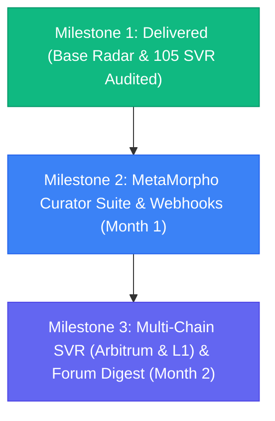

# [MIP-81 / MIP-93 Proposal] Werracle: MetaMorpho Curator Risk Radar & Independent SVR Telemetry Infrastructure

**Category:** Tooling, Risk Research & Public Good Infrastructure  
**Target Forum:** Morpho DAO Forum (`forum.morpho.org`)  
**Status:** FINAL PROPOSAL — READY FOR FORUM SUBMISSION  
**Applicant:** ITouch Systems / Werracle Research & Security Desk  
**Contact:** Volkan Dağlı (`pcworm@pcworm.net`) | Adana Çukurova Teknokent, Turkey  
**Repository:** [https://github.com/pCwOrM/werracle](https://github.com/pCwOrM/werracle)  
**Live Observatory:** [https://radar.werracle.com](https://radar.werracle.com) | [https://werracle.io/radar.html](https://werracle.io/radar.html)  
**Live Telemetry API:** [https://api.werracle.com/v1/radar/overview](https://api.werracle.com/v1/radar/overview) | [/v1/radar/oev-analytics](https://api.werracle.com/v1/radar/oev-analytics)  
**Citable Empirical Research DOI:** [https://doi.org/10.5281/zenodo.23623588](https://doi.org/10.5281/zenodo.23623588) (Zenodo Record: [23623589](https://zenodo.org/records/23623589))  
**Hugging Face Dataset:** [https://huggingface.co/datasets/pCwOrM/werracle-oev-liquidation-dataset-2026](https://huggingface.co/datasets/pCwOrM/werracle-oev-liquidation-dataset-2026)  
**Empirical Paper:** [`docs/EMPIRICAL_OEV_AND_LIQUIDATION_RESEARCH_2026.md`](https://github.com/pCwOrM/werracle/blob/main/docs/EMPIRICAL_OEV_AND_LIQUIDATION_RESEARCH_2026.md)  

---

## 1. Executive Summary

As Morpho Blue and MetaMorpho vaults scale across Layer-2 rollups, transparent and independent telemetry on **liquidation efficiency, Oracle Extractable Value (OEV) recapture, and borrower risk distribution** is vital for depositors, risk curators (e.g., Steakhouse Financial, Gauntlet, Re7 Labs, B.Protocol), and DAO governance.

Unlike traditional grant proposals that request upfront capital for unbuilt prototypes, **Werracle has already built, tested, and deployed a production-grade, public-good risk radar and empirical auditing engine**:
- **Live 24/7 Monitoring:** Tracks **83 Morpho Blue markets** and **69,000+ borrower positions** on Base with sub-second health factor surveillance.
- **Empirically Audited SVR Performance:** Decoded all 105 Chainlink Smart Value Recapture (SVR) liquidation transactions on Base Morpho during the October 12–19, 2026 volatility window ($190,506.31 gross collateral), proving independently that **98.10% ($186,889.85 USD)** of gross liquidation value was successfully recaptured and returned directly to Morpho vaults and depositors.
- **Multi-Call Receipt Decoding:** Solved the single-event undercounting problem by building an atomic sub-call parser capable of accurately decoding bundled transactions with up to **32 liquidation sub-calls** in a single execution.
- **Solver Decentralization Verified:** Confirmed active participation from **20 distinct solver contract architectures and 27 signing EOAs** (top solver volume share capped at 31.64%), proving genuine Bertrand competition without monopolistic cartel capture.

Through this grant application under MIP-81 / MIP-93, we propose maintaining this public infrastructure, adding dedicated **MetaMorpho Vault Curator Risk Dashboards**, expanding multi-call SVR ingestion to **Arbitrum and Ethereum L1**, and delivering automated weekly risk digests to the Morpho governance forum.

---

## 2. Problem Statement & Motivation

### 2.1 The Visibility Void for MetaMorpho Vault Curators
MetaMorpho curators allocate hundreds of millions in deposits across diverse Morpho Blue market pairs (e.g., `cbBTC/USDC`, `WETH/USDC`, `cbXRP/USDC`). However, curators currently lack:
1. **Granular Health Horizons:** Real-time visibility separating active pre-liquidation risk ($0.95 \le HF < 1.10$) from dormant legacy bad debt ($HF < 0.95$, such as decommissioned oracle assets).
2. **Borrower Exposure Concentration:** Market-level borrower density metrics to anticipate cascading collateral pressure before volatility breaches liquidation thresholds.
3. **Automated Alert Webhooks:** Low-latency notifications when large borrower cohorts cluster near the Liquidation Loan-to-Value (LLTV) threshold.

### 2.2 Independent Verification of SVR & OEV Recapture
Order Flow Auctions (OFA) like Chainlink SVR are designed to eliminate MEV leakage by forcing searchers/solvers to bid away liquidation bonuses back to protocol vaults. While theoretical claims exist, the Morpho community requires **independent, on-chain empirical proof**:
- Are solvers truly competing away their margins?
- Is value actually flowing back to vault depositors?
- Are atomic multi-call liquidations behaving safely under high network congestion?

Werracle answers these questions with audited, open-source data.

---

## 3. What Werracle Has Already Delivered (Milestone 1 — Completed)

Prior to requesting grant funding, Werracle developed, deployed, and validated the following public infrastructure:

### 3.1 Live Production Risk Radar
- **URLs:** [https://radar.werracle.com](https://radar.werracle.com) | [https://werracle.io/radar.html](https://werracle.io/radar.html)
- **Coverage:** 83 Morpho Blue markets on Base.
- **Telemetry Throughput:** Over **275,000 flashblocks processed** and **5.5M+ transactions decoded**.
- **Risk Segmentation:** Delineates **~4,800 active positions near liquidation** ($0.95 \le HF < 1.10$) from **82 legacy bad debt positions** ($HF < 0.95$), preventing distorted risk signals.

### 3.2 Audited Empirical Dataset (October 12–19, 2026 Baseline)
- **Public API:** `GET https://api.werracle.com/v1/radar/overview`  
- **Dataset Endpoint:** `GET https://radar.werracle.com/v1/radar/dataset`  
- **Zenodo DOI:** [https://doi.org/10.5281/zenodo.23623588](https://doi.org/10.5281/zenodo.23623588) (Record: `23623589`)
- **Hugging Face Hub:** [`pCwOrM/werracle-oev-liquidation-dataset-2026`](https://huggingface.co/datasets/pCwOrM/werracle-oev-liquidation-dataset-2026) (Interactive Table Viewer & `load_dataset`)  
- **Audited Metrics:**
  - **Gross Liquidated Value:** $190,506.31 USD across 105 Base SVR events.
  - **Protocol Recaptured Bids:** **$186,889.85 USD (98.10% recapture rate)**.
  - **Pre-Swap Solver Net Margin:** $3,545.73 USD (1.86% share).
  - **Median Solver Margin:** **-1.55%** (61.9% of transactions concluded at zero or negative net profit before DEX swap slippage).
  - **Decentralization:** 20 unique solver contracts, 27 unique signing EOAs; top solver volume capped at 31.64%.
  - **Multi-Call Bundles:** 64.76% (68 of 105 txs) were bundled multi-calls with up to 32 sub-calls in a single transaction.

### 3.3 Top Market Exposure Telemetry
Empirical breakdown of where SVR liquidation volume occurred during market stress:
- `cbXRP / USDC` (LLTV 62.5%): 18,801 borrowers | $88,801.33 gross liquidated (46.61% of total) | 96.19% recaptured.
- `SOL / USDC` (LLTV 62.5%): 4,172 borrowers | $27,790.95 gross liquidated | 96.10% recaptured.
- `cbLTC / USDC` (LLTV 62.5%): 1,771 borrowers | $17,056.41 gross liquidated | 95.50% recaptured.
- `WETH / USDC` (LLTV 86.0%): 23,182 borrowers | $14,907.65 gross liquidated | 98.40% recaptured.
- `cbBTC / USDC` (LLTV 86.0%): 72,055 borrowers | Routine micro-liquidations | 98.51% recaptured.

---

## 4. Proposed Scope of Work & Roadmap

We propose a 2-month execution roadmap to expand Werracle into a dedicated, institutional-grade risk suite for the Morpho ecosystem:

### Milestone 1: Live Base Radar & Verified Dataset (COMPLETED & VERIFIED)
- **Status:** Delivered & Active in Production.
- **Deliverables:**
  - Public dashboard and REST API monitoring 83 Morpho markets on Base.
  - Audited multi-call SVR empirical dataset and comprehensive research paper.
  - Zero-drift sealed daemon architecture with sub-second WebSocket flashblock decoding.

### Milestone 2: MetaMorpho Vault Curator Suite & Alert Webhooks (Month 1)
- **Objective:** Tailor the observatory specifically to MetaMorpho vault curators (Steakhouse, Gauntlet, Flagship, Re7).
- **Deliverables:**
  1. **Vault-Level Risk Aggregation:** Dedicated dashboard views mapping collateral risk directly to specific MetaMorpho vaults (e.g., Flagship USDC, Steakhouse USDC, Re7 WETH).
  2. **Curator Alert Webhooks:** Configurable Discord/Telegram/Slack webhook dispatchers that notify risk teams when:
     - Cumulative borrow volume with $1.00 \le HF < 1.05$ exceeds $500,000 in any single market.
     - Oracle price approaches within 1.5% of market LLTV.
  3. **Curator API Endpoints:** Dedicated `/v1/radar/curator/{vault_address}` endpoint providing instantaneous health distribution histograms.

### Milestone 3: Cross-Chain Expansion (Arbitrum & L1) & Governance Digest (Month 2)
- **Objective:** Expand multi-call decoding beyond Base and provide regular risk transparency to Morpho governance.
- **Deliverables:**
  1. **Arbitrum Morpho Blue Ingestion:** Deploy dedicated rate-limited archival RPC decoders to audit Arbitrum SVR and liquidation auctions.
  2. **Ethereum L1 Builder Payment Comparator:** Live tracking comparing L2 SVR protocol recapture rates against Ethereum L1 private builder bundle payments.
  3. **Automated Bi-Weekly Governance Forum Reports:** Automated, markdown-formatted reports posted directly to the Morpho DAO forum summarizing:
     - Bi-weekly liquidation volume across all Morpho markets.
     - Exact dollar and percentage value recaptured by SVR for depositors.
     - Solver competition health and margin spreads.

---

## 5. Budget & Funding Request

We request a total grant of **15,000 USDC**, distributed according to milestone completion:

| Milestone | Scope | Timeline | Funding Requested |
| :--- | :--- | :--- | :--- |
| **Milestone 1** | Live Base Observatory & Audited SVR Dataset | Delivered | **5,000 USDC** (Retroactive/Initial) |
| **Milestone 2** | MetaMorpho Curator Suite, Vault Mapping & Alert Webhooks | 4 Weeks | **5,000 USDC** |
| **Milestone 3** | Arbitrum Expansion, L1 Comparator & Governance Reports | 4 Weeks | **5,000 USDC** |
| **Total** | Full Institutional Risk Radar for Morpho Ecosystem | **8 Weeks** | **15,000 USDC** |

*Payment Destination:* Multi-sig or safe address specified upon grant approval.

---

## 6. Team & Technical Credentials

- **Lead Researcher & Engineer:** Volkan Dağlı (Founder, ITouch Systems / Werracle Research Desk)  
  - Background in systems programming, high-frequency telemetry, and formal verification.
  - Author of Lean 4 formal verification specifications for on-chain automated market mechanisms ([Werracle Lean 4 Repository](https://github.com/pCwOrM/werracle)).
- **Infrastructure:** Bare-metal dedicated nodes (`pcworm-root`), redundant Cloudflare strict-SSL edge network, and 24/7 autonomous monitoring daemons.
- **Commitment to Open Source:** All decoder scripts, API routers, and empirical datasets are 100% open-source under the MIT license for community verification.

---

## 7. Verification & Community Links

- **Citable Research DOI:** [https://doi.org/10.5281/zenodo.23623588](https://doi.org/10.5281/zenodo.23623588)  
- **Zenodo Open Science Archive:** [https://zenodo.org/records/23623589](https://zenodo.org/records/23623589)  
- **Web Dashboard:** [https://radar.werracle.com](https://radar.werracle.com)  
- **Public Good Portal:** [https://werracle.io/radar.html](https://werracle.io/radar.html)  
- **Live JSON Overview:** [https://api.werracle.com/v1/radar/overview](https://api.werracle.com/v1/radar/overview)  
- **Live Analytics API:** [https://api.werracle.com/v1/radar/oev-analytics](https://api.werracle.com/v1/radar/oev-analytics)  
- **Empirical Research Paper:** [https://github.com/pCwOrM/werracle/blob/main/docs/EMPIRICAL_OEV_AND_LIQUIDATION_RESEARCH_2026.md](https://github.com/pCwOrM/werracle/blob/main/docs/EMPIRICAL_OEV_AND_LIQUIDATION_RESEARCH_2026.md)  
- **GitHub Repository:** [https://github.com/pCwOrM/werracle](https://github.com/pCwOrM/werracle)  

---
*We look forward to community feedback and partnering with the Morpho DAO Grants Committee to advance risk transparency across the ecosystem.*
