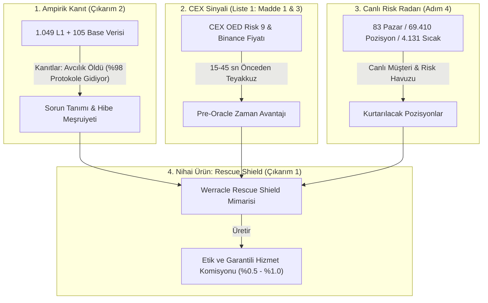

# Werracle Bütünleşik İş Planı ve Kalkan (Rescue Shield) Yol Haritası

**Tarih:** 23 Ekim 2026  
**Doküman Kodu:** `WERRACLE-PLAN-2026-V1`  
**Amaç:** Askıya alınan modüller (Liste 1), ampirik veri seti (Çıkarım 2) ve kurtarma kalkanı vizyonunu (Çıkarım 1) birbiriyle karşılıklı (mutual) beslenen tek bir organik ekosistem mimarisinde birleştirmek.

---

## 1. Sistemsel Simbiyoz: Birbirini Besleyen Çarklar

Werracle'ın elindeki bileşenler birbirinden kopuk bağımsız araçlar değildir; her biri bir diğerinin yakıtı ve varlık sebebidir:

### 🔄 3 Temel Besleme Döngüsü:

1. **Döngü 1: 1.049 L1 Verisi ➔ Kalkanın Varlık Sebebini Doğrular**  
   Piyasada *"Neden tasfiye botu yazmıyorsun?"* diyenlere elimizdeki 1.049 L1 ve 105 Base verisi cevap verir: *"Çünkü açık artırmalar kârın %98'ini protokole iade ediyor, botlar başabaş kalıyor (%-1.5 medyan). O halde sürdürülebilir tek gelir, borçluyu batmadan önce koruyan kalkandır."*
2. **Döngü 2: CEX-Öncü Kahin + OED Risk ➔ Kalkanın Süper Gücünü Verir**  
   Standart bir koruma botu zincir üstündeki Chainlink fiyatına bakar; ama o fiyat güncellendiğinde artık çok geçtir (pozisyon batmıştır). Bizim WERR motorumuz Binance fiyatının Chainlink'ten **15–45 saniye önce düşmesini** ve CEX OED Risk 9 stresini okuyarak pozisyonu henüz HF = 1.02 iken, herkesten önce kurtarır.
3. **Döngü 3: 4.131 Sıcak Pozisyon ➔ Kalkanın Gelir Motorunu Besler**  
   Radarımızdaki 4.131 sıcak pozisyon soyut bir rakam değildir; kurtarılmayı bekleyen gerçek borçlulardır. Flaş kredi ile teminatın %10'u satılıp borç kısmen kapatıldığında borçlu %5–10 tasfiye cezasından kurtulur, Werracle kurtarılan ceza üzerinden %0.5–%1.0 net komisyon üretir.

---

## 2. Dört Fazlı Eylem Planı ve Yapılacaklar Listesi

---

### FAZ 1: Veri Sentezi ve Akademik Zemin (Girdi Katmanı)
*Bu faz, projenin bilimsel itibarını ve hibe başvurusunun dayanağını oluşturur.*

1. **Adım 1.1 — Veri Setinin Konsolidasyonu (`werracle_oev_empirical_dataset_2026.json`):**
   * Sunucudaki `denetci_l1_siniflandir.json` (1.049 L1 tasfiyesi) ile Base'deki 105 SVR işlemini tek bir temiz, standart JSON şemasında birleştirmek.
2. **Adım 1.2 — Pazar ve Borçlu İndeksleyici Hijyeni (Liste 1 Madde 2):**
   * 83 pazara ek olarak gözden kaçan 5 pazar ve 4 borçlunun indeksleme filtresini güncelleyerek veri kaçağını sıfırlamak.
3. **Adım 1.3 — Ampirik Araştırma Raporunun Üretilmesi:**
   * `docs/EMPIRICAL_OEV_AND_LIQUIDATION_RESEARCH_2026.md` dosyasında tam teşekküllü, grafik ve tablolar içeren bir ampirik araştırma dokümanı oluşturmak.

---

### FAZ 2: Kalkan Simülasyonu ve Ekonomik Model (Ürün Katmanı)
*Bu faz, kurtarma kalkanının ne kadar para kazandıracağını ve tasarruf ettireceğini simüle eder.*

1. **Adım 2.1 — Sıcak Pozisyonların Risk Dökümü:**
   * Sunucudaki 4.131 sıcak pozisyon taranarak en büyük 20 borçlunun teminat/borç hacmi, pazar dağılımı (WETH, cbETH, USDC) ve HF seviyeleri listelenecek.
2. **Adım 2.2 — Kalkan Simülatörü Yazımı (`scripts/simulate_rescue_shield.py`):**
   * Simülasyon Senaryosu: Pozisyon HF = 1.02 olduğunda, teminatın %10–15'i flaş krediyle DEX piyasa fiyatından satılarak borç kısmen ödenir ve HF = 1.25'e yükseltilir.
   * Çıktı:
     * Borçlunun kurtardığı toplam tasfiye cezası ($ cinsinden),
     * Ödenen DEX takas ücreti (%0.1),
     * Werracle'a kalan net hizmet primi (%0.5 – %1.0).
3. **Adım 2.3 — CEX-Öncü Kahin Entegrasyon Taslağı (Liste 1 Madde 1 & 3):**
   * Binance anlık fiyat düşüşü ile Chainlink L1/L2 blok yazımı arasındaki 15–45 saniyelik gecikmenin kalkan tetikleyicisi olarak algoritması çıkarılacak.

---

### FAZ 3: Bütünleşik Pano ve API Entegrasyonu (Görünürlük Katmanı)
*Bu faz, simülasyonu ve verileri canlı dünyaya sunar.*

1. **Adım 3.1 — Dashboard'a Kalkan Simülatörü Sekmesi Eklenmesi:**
   * [https://pcworm.net/v1/radar/dashboard](https://pcworm.net/v1/radar/dashboard) sayfasına "Rescue Shield Simulator" paneli eklenerek canlı kurtarılabilir değer ($) ve önlenen ceza ($) gösterilecek.
2. **Adım 3.2 — API Uç Noktası (`GET /v1/radar/rescue-simulation`):**
   * Kurumsal fonlar ve protokoller için simülasyon çıktılarını JSON olarak sunan uç nokta aktif edilecek.

---

### FAZ 4: Dağıtım, Hibe ve İtibar (Çıktı Katmanı)
*Bu faz, hazır ve çalışan ürünle dış dünyaya açılma adımıdır.*

1. **Adım 4.1 — Morpho Forum Hibe Teklifi (MIP-81 / MIP-93):**
   * "Biz bir bot değiliz; 1.049 L1 işlemini inceleyen, 83 pazarda 69k pozisyonu izleyen ve Morpho borçlularını tasfiye cezasından koruyan açık kaynak bir Kamu Yararı (Public Good) Kalkanıyız" başvurusu yapılacak.
2. **Adım 4.2 — Saygın Veri Gazeteciliği Lansmanı (Twitter / X & Substack):**
   * Doğrulanmış rakamlarla (%98 protokol yakalaması, -%1.5 medyan marj, kurtarma kalkanı vizyonu) saygın ve teknik bir flood yayınlanacak.

---

## 3. Öncelik Sıralaması (Hemen Yapılacak İlk 2 İşlem)

1. **ÖNCELİK 1 (Hemen):** Sunucudaki 4.131 sıcak pozisyon arasından en büyük borçluları analiz eden ve kalkan kâr/tasarruf simülasyonunu çalıştıran `scripts/simulate_rescue_shield.py` scriptini yazıp koşturmak.
2. **ÖNCELİK 2:** 1.049 L1 + 105 Base verisini birleştiren ve akademik araştırma dokümanını (`docs/EMPIRICAL_OEV_AND_LIQUIDATION_RESEARCH_2026.md`) derlemek.
