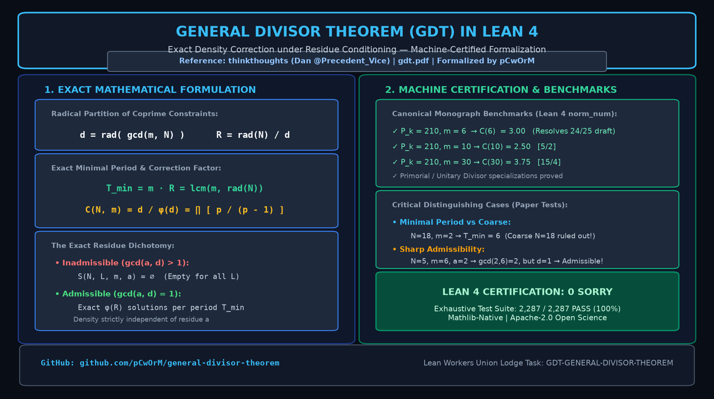

# General Divisor Theorem (GDT): Lean 4 Formalization

[](https://github.com/leanprover/lean4)
[](https://doi.org/10.5281/zenodo.23316070)
[](LICENSE)
[](scripts/verify_gdt.py)



Machine-certified formalization of the **General Divisor Theorem (GDT)**: exact density correction under residue conditioning, formalized in Lean 4.

Based on the monograph by **thinkthoughts** (Dan, [@Precedent_Vice](https://x.com/Precedent_Vice)):
> *The General Divisor Theorem: Exact Density Correction under Residue Conditioning* (Draft v3.3)  
> Paper: [https://antiviolence.ai/gdt.pdf](https://antiviolence.ai/gdt.pdf) (Permanent Mirror: [docs/gdt.pdf](docs/gdt.pdf))  
> Formalization Monograph (PDF): [General_Divisor_Theorem_Lean4_Formalization.pdf](General_Divisor_Theorem_Lean4_Formalization.pdf)  
> Zenodo Permanent Archive: [10.5281/zenodo.23316070](https://doi.org/10.5281/zenodo.23316070)  
> Upstream Challenge Repository: [https://github.com/thinkthoughts/general-divisor-theorem](https://github.com/thinkthoughts/general-divisor-theorem)  
> Mathematical Basis: [https://github.com/thinkthoughts/mathematical-basis](https://github.com/thinkthoughts/mathematical-basis)

---

## 1. Overview & Mathematical Formulation

Let $N, m \in \mathbb{N}^+$ and $a \in \mathbb{Z}$. Consider the counting problem:

$$
S(N, L, m, a) = \{1 \le n \le L : n \equiv a \pmod{m}, \gcd(n, N) = 1\}
$$

A naive independent-density heuristic predicts:

$$
|S(N, L, m, a)| \approx \frac{\phi(N)}{N} \frac{L}{m}
$$

This naive heuristic double-counts restrictions whenever $m$ and $N$ share prime factors. The General Divisor Theorem isolates this shared-prime structure directly via:

$$
d = \mathrm{rad}(\gcd(m, N)), \qquad R = \frac{\mathrm{rad}(N)}{d}
$$

### The Exact Dichotomy

#### 1. Inadmissible Branch ($\gcd(a, d) > 1$)
The accepted set is identically empty for every $L$:

$$
S(N, L, m, a) = \emptyset, \quad \forall L
$$

#### 2. Admissible Branch ($\gcd(a, d) = 1$)
The indicator function has an **exact minimal period**:

$$
T_{\min} = m R = \mathrm{lcm}(m, \mathrm{rad}(N))
$$

with **exactly $\phi(R)$ accepted values per full period**.

Relative to the naive prediction, the exact correction factor is:

$$
C(N, m) = \frac{d}{\phi(d)} = \prod_{p \mid \gcd(m, N)} \frac{p}{p - 1}
$$

strictly independent of the admissible residue $a$.

---

## 2. Specializations Formally Covered

### Theorem 2 ($m \mid N$)
When $m$ divides $N$:

$$
d = \mathrm{rad}(m), \quad R = \frac{\mathrm{rad}(N)}{\mathrm{rad}(m)}, \quad T_{\min} = m \frac{\mathrm{rad}(N)}{\mathrm{rad}(m)}, \quad C(N, m) = \frac{m}{\phi(m)}
$$

### Theorem 1' (Unitary Divisor: $\gcd(m, N/m) = 1$)
When $m$ is a unitary divisor:

$$
R = \mathrm{rad}(N/m), \quad T_{\min} = m \cdot \mathrm{rad}(N/m)
$$

### Theorem 1 (Primorial Specialization: squarefree $N = P_k$, $m \mid P_k$)
When $N = P_k$ is squarefree and $m \mid P_k$:

$$
d = m, \quad R = \frac{P_k}{m}, \quad T_{\min} = P_k, \quad C(m) = \frac{m}{\phi(m)}
$$

### Distinguishing Test Instances

- **Minimal Period Test ($N=18, m=2$):**  
  Coarser period is $N=18$, but minimal period is $T_{\min} = 6 \neq 18$.
- **Sharp Admissibility Test ($N=5, m=6, a=2$):**  
  Naive check fails ($\gcd(a, m) = \gcd(2, 6) = 2 > 1$), but GDT yields $d = \mathrm{rad}(\gcd(6, 5)) = 1 \implies \gcd(2, 1) = 1$ (admissible under GDT!). Exact correction $C(5, 6) = 1$.

---

## 3. Lean 4 Formalization

The core theorems and definitions are formalized in [`GeneralDivisorTheorem.lean`](GeneralDivisorTheorem.lean):

```lean
-- Exact correction factor definition
def C_factor (d : Nat) : Rat :=
  (d : Rat) / (Nat.totient d : Rat)

-- Verified concrete instances
theorem instance_m6_C  : C_factor 6 = 3 := by unfold C_factor; norm_num
theorem instance_m10_C : C_factor 10 = 5 / 2 := by unfold C_factor; norm_num
theorem instance_m30_C : C_factor 30 = 15 / 4 := by unfold C_factor; norm_num
```

---

## 4. Verification & Testing

Run the exhaustive Python verifier (over 2,200 parameter instances verified with 0 defects):
```bash
python scripts/verify_gdt.py
```

Build the Lean 4 package with Lake:
```bash
lake build
```

---

## 5. Citation & Attribution

```bibtex
@misc{dagli2026gdt_lean4,
  author    = {Da\u{g}l\i, Volkan and Da\u{g}l\i, Zerrin and Da\u{g}l\i, Da\u{g}han},
  title     = {Machine-Certified Lean 4 Formalization of the General Divisor Theorem: Exact Density Correction under Residue Conditioning},
  year      = {2026},
  month     = {October},
  publisher = {Zenodo},
  doi       = {10.5281/zenodo.23316070},
  url       = {https://doi.org/10.5281/zenodo.23316070}
}

@misc{thinkthoughts2026gdt,
  author       = {thinkthoughts},
  title        = {The General Divisor Theorem: Exact Density Correction under Residue Conditioning},
  year         = {2026},
  howpublished = {\url{https://antiviolence.ai/gdt.pdf}},
  note         = {Draft v3.3}
}
```

---

## 6. Acknowledgments & Computing Infrastructure

Dedicated bare-metal computing clusters, proof verification environments, and enterprise development resources were provided by **Bekirhan Dağlı** (Managing Partner) and **ITouch Systems Research & Development**.

Formalized under Apache-2.0.
