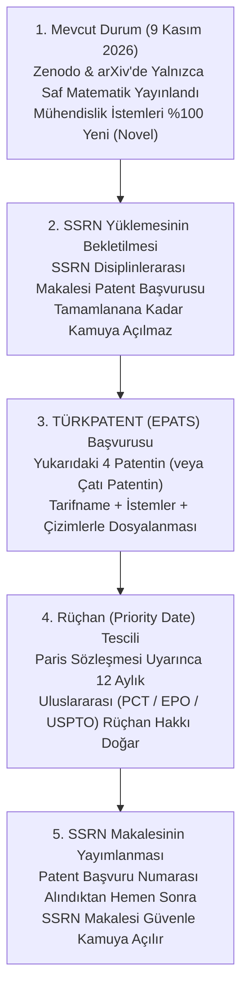

# 📜🛡️ Holomorfik Dinamikler, Deniz Sibernetiği ve Hukuk Bilişimi Çalışmalarının Patentlenebilirlik Analizi ve 4 Patent Ailesi Strateji Raporu

> **Mühürlü Arşiv ve PDF Dosya Konumları:**
> * 🖨️ **Resmi Patent Strateji Raporu PDF:** [WERR_Patentlenebilirlik_Analizi_ve_4_Patent_Ailesi_Strateji_Raporu.pdf](file:///c:/Users/maat/Documents/antigravity/wonderful-raman/SEALED_COLLATZ_PUBLICATIONS_VAULT_2026/08_PATENT_STRATEJISI_VE_4_PATENT_AILESI/WERR_Patentlenebilirlik_Analizi_ve_4_Patent_Ailesi_Strateji_Raporu.pdf)
> * 📝 **İzole Kasa Markdown Kaynağı:** [PATENTABILITE_VE_FIKRI_MULKIYET_STRATEJISI_RAPORU.md](file:///c:/Users/maat/Documents/antigravity/wonderful-raman/SEALED_COLLATZ_PUBLICATIONS_VAULT_2026/08_PATENT_STRATEJISI_VE_4_PATENT_AILESI/PATENTABILITE_VE_FIKRI_MULKIYET_STRATEJISI_RAPORU.md)

---

## ⚖️ 1. Hukuki Çerçeve: Hangi Kısım Patentlenemez, Hangi Kısım Doğrudan Patentlenir?

Ulusal ve uluslararası patent mevzuatında (**6769 sayılı Sınai Mülkiyet Kanunu Madde 82/2-a**, **Avrupa Patent Sözleşmesi EPC Madde 52(2)(a)-(3)** ve **ABD 35 U.S.C. § 101**) temel ayrım **"Soyut Matematiksel Teorem"** ile **"Teknik Karakter Taşıyan Mühendislik Uygulaması"** arasındadır:

| İncelenen Katman | Hukuki Statüsü | Yasal Dayanak & İçtihat | Sonuç |
| :--- | :--- | :--- | :--- |
| **1. Saf Matematiksel Denklemler (Zenodo Monografisi)** $f(z)$ ve $F(z)$ tam fonksiyonları, Fatou çarpanı $\mu=3/4$, Koenigs Taylor katsayıları ($c_2, d_2$) ve 2-adik Haar integrali. | *"Münhasıran (as such) matematiksel yöntem"* kapsamında **tek başına soyut formül olarak patentlenemez**; `CC-BY-4.0` ve `MIT` telif/yazılım lisanslarıyla korunur. | SMK Madde 82/2-a ve 82/3; EPC Madde 52(2)(a) ve 52(3); Bern Sözleşmesi; WIPO (WCT Madde 4). | ❌ Soyut formül olarak patent dışı ✅ Telif hakkı ile tam koruma altında |
| **2. Siber-Fiziksel Kontrol, Sensör Filtreleme ve Otopilot Güvenlik Mimarisi (SSRN Çalışması + Uygulama Katmanı)** Otonom gemi (MASS) dümen/itki kontrolü, GPS spoofing filtreleme, kara kutu AI devre kesici watchdog ve CubeSat yönelim sönümleme. | Fiziksel bir sistemi (gemi, İHA, uydu, işlemci) sensör verisine göre kontrol ettiği ve somut bir teknik problemi çözdüğü için **"Teknik Karakter" (Technical Character)** taşır ve **tamamen patentlenebilir.** | **EPO Guidelines G-II, 3.3** (*Mathematical Methods contributing to technical character*); TÜRKPATENT Bilgisayar Uygulamalı Buluşlar Kılavuzu. | ✅ **Doğrudan Patentlenebilir (4 Ayrı Patent Ailesi)** |

---

## ⏳ 2. Kritik Takvim Analizi: "Yenilik (Novelty)" ve "12 Aylık Hoşgörü Süresi (Grace Period)"

Patent stratejisi açısından mevcut durumunuz **üç büyük avantaja** sahiptir:

1. **Zenodo (`10.5281/zenodo.24060394`) ve arXiv (`arXiv:2611.11641 [cs.LO]`) Yayınlarınız Sadece Saf Matematiği Açıkladı:**
   9 Kasım 2026 tarihinde kamuya açılan Zenodo ve arXiv paketlerinde **gemi dümen aktüatörü kontrolü, oşinografik sensör füzyonu, GPS spoofing filtresi, CubeSat manyetik tork kontrolü veya yapay zekâ devre kesici donanım kapısı (watchdog) yer almamaktadır.** Dolayısıyla mühendislik istemleriniz (claims) henüz dünyanın hiçbir yerinde tekniğin bilinen durumuna (*prior art*) girmemiştir.
2. **SSRN Disiplinlerarası Makalesi Henüz Kamuya Yüklenmedi:**
   Deniz sibernetiği ve kontrol bariyeri mimarisini içeren SSRN makalesini internete yüklemeden önce **TÜRKPATENT (EPATS)** üzerinden ulusal patent başvurularınızı yaptığınız anda, **Paris Sözleşmesi** uyarınca tüm dünyada geçerli **12 aylık uluslararası rüçhan (priority) hakkınız** doğar. Böylece **Avrupa Patent Ofisi (EPO)** ve **PCT** nezdinde **%100 Mutlak Yenilik (Absolute Novelty)** korunmuş olur.
3. **Türkiye (TÜRKPATENT) ve ABD (USPTO) İçin "12 Aylık Hoşgörü Süresi (Grace Period)" Güvencesi:**
   * **Türkiye (6769 sayılı SMK Madde 84/1-a):** Buluş sahibi tarafından başvuru tarihinden önceki **12 ay içinde** yapılan bilimsel yayınlar buluşun yeniliğini etkilemez.
   * **ABD (35 U.S.C. § 102(b)(1) — AIA Grace Period):** Yazarların kendi yayınlarından itibaren **12 ay boyunca** USPTO nezdinde patent başvuru hakkı korunur.
   * **Stratejik Kural:** Türkiye ve ABD'de **9 Kasım 2027** tarihine kadar yasal hoşgörü süreniz mevcuttur; ancak Avrupa (EPO) mutlak yenilik aradığı için **önce EPATS patent başvurusu $\rightarrow$ ardından SSRN yayını** sıralaması en kusursuz yoldur.

---

## 🛠️ 3. Çıkarılabilecek 4 Bağımsız Patent Ailesi ve Teknik İstem Mimarileri

Aşağıdaki 4 buluş, ister **tek bir kapsamlı Çatı Patent (Umbrella Patent)** altında 4 bağımsız istem grubu olarak, ister **4 ayrı patent başvurusu** olarak TÜRKPATENT'e sunulabilir:

### ⚓ PATENT 1: Otonom Deniz Araçları (IMO MASS) İçin Holomorfik Faz Uzayı ve Koenigs Hunisi Tabanlı Seyir ve Demirleme Kontrol Sistemi

* **Önerilen Buluş Başlığı:** *Çift Rejimli Hidrodinamik Akıntılarda Holomorfik Faz Uzayı ve Koenigs Doğrusallaştırma Hunisi Tabanlı Otonom Deniz Aracı Seyir ve Demirleme Kontrol Sistemi ve Yöntemi*
* **IPC / CPC Sınıfları:** `B63H 25/04` (Otonom gemi dümen kontrolü), `G05D 1/02` (Rota ve konum kontrolü), `G06F 17/10`.
* **Çözdüğü Teknik Problem:** Derin öğrenme veya standart PID kontrolcülerinin ekstrem yan akıntı darbelerinde (cross-current surges) ıraksaması ve liman içi demirlemede salınım enerjisini sönümleyememesi.
* **Bağımsız İstem (Claim 1) Yapısı:**
  1. Gemideki seyrüsefer sensörlerinden (GNSS, IMU, Doppler Akıntı Profilleyici - ADCP) anlık konum ve hız sapma vektörünün ($\vec{v}(z)$) okunması birimi,
  2. Sapma adımlarını $\vec{v}(z) = -\frac{z}{2} + \frac{2z+1}{4}(1 - \cos(\pi z))$ sürekli faz uzayı modeline göre merkeze çekici sönümleme kanalları ($N_{\text{even}}, |f'|=0.5$) ve dışarı savurucu türbülans darbeleri ($N_{\text{odd}}, |f'|=1.5$) olarak ayrıştıran gerçek zamanlı parite işlemcisi,
  3. Kümülatif $N_{\text{even}}/N_{\text{odd}}$ oranını $\gamma_{\text{crit}} = \ln(3/2)/\ln 2 \approx 0.58496$ eşiğiyle karşılaştırarak, oran eşik altına yaklaştığında gemi dümen (rudder) ve baş/kıç iticilerine (thrusters) otomatik faz-düzeltme darbesi üreten kontrol bariyeri birimi,
  4. Liman yaklaşma koridorunda Koenigs doğrusallaştırma potansiyeli $\Phi_j(f^{\circ 2}(z)) = \frac{3}{4}\Phi_j(z)$ ve ikinci derece eğrilik katsayıları ($c_2 = -\frac{13}{2}\pi^2, d_2 = -\frac{9}{2}\pi^2$) üzerinden her manevra çevriminde salınım enerjisini %25 oranında ($\mu=0.75$) sönümleyerek 10 çevrimde %94,37 sönümleme sağlayan terminal demirleme modülü.

---

### 🛡️ PATENT 2: Otonom Siber-Fiziksel Sistemlerde Kara Kutu Yapay Zekâyı Denetleyen "Biçimsel Doğrulanmış Güvenlik Kapısı (Fail-Safe Control Barrier Watchdog)"

* **Önerilen Buluş Başlığı:** *Otonom Siber-Fiziksel Sistemlerde Olasılıksal Yapay Zekâ Komutlarını Julia Faz Sınırı ve Biçimsel Doğrulama Çekirdeği İle Denetleyen Donanım/Yazılım Devre Kesici Sistem*
* **IPC / CPC Sınıfları:** `G05B 9/02` (Güvenlik kontrol sistemleri), `G06N 3/08`, `G06F 11/07`.
* **Çözdüğü Teknik Problem:** Otonom araçlarda (gemi, İHA, otonom kara aracı) kullanılan sinir ağı (kara kutu AI) kontrolcülerinin öngörülemeyen uç durumlarda aracı kararsız faz bölgesine sokacak tehlikeli aktüatör komutları üretmesi ve AB Yapay Zekâ Yasası (Madde 15) uyumluluk eksikliği.
* **Bağımsız İstem (Claim 1) Yapısı:**
  1. Birincil olasılıksal yapay zekâ (derin sinir ağı) kontrolcüsünden çıkan aday kontrol komutunu aktüatörlere (motor/dümen/servo) ulaşmadan önce yakalayan donanım/yazılım ara katmanı (watchdog),
  2. Aday komutun oluşturacağı bir sonraki durum koordinatını $\mathcal{O}_{\text{rep}} = \{2.4046, 3.0951\} \subset \mathcal{J}(f)$ ($\mu_{\text{rep}} \approx 1.2148 > 1$) itici Julia faz sınırı ile karşılaştıran deterministik sınır denetleyicisi,
  3. Aday komutun aracı $\mathcal{B}(\mathcal{O}_{1,2})$ çekim havzası dışına çıkardığının tespiti halinde sinir ağı komutunu milisaniye altında **veto ederek (devre kesici)**, Lean 4 çekirdeğinde doğrulanmış güvenli Koenigs büzülme komutuyla ($\mu = 0.75$) değiştiren emniyet anahtarı.

---

### 📡 PATENT 3: Elektronik Harp ve GPS/AIS Spoofing (Sahte Konum Saldırısı) Sönümleme ve İzolasyon Filtresi
* **TÜRKPATENT Resmi Başvuru No:** **`TR 2026/020266`** *(Evrak No: `2026-GE-810833`, Tahakkuk: `4530669`, Tarih: `10.11.2026 21:23:44`)*
* **Başvuru Sahibi:** Volkan DAĞLI
* **Buluş Sahipleri (Mucitler):** Volkan DAĞLI, Zerrin DAĞLI, Dağhan DAĞLI, Emrah YURTSEVER, Murat Emre ÖZKAN
* **Önerilen Buluş Başlığı:** *Deniz ve Hava Seyrüsefer Sistemlerinde Sahte Konum Enjeksiyonlarını (GPS/AIS Spoofing) 2-Adik Ergodik Parite Bariyeri ve Negatif Schwarzian Filtresi İle Tespit ve İzole Eden Siber-Fiziksel Güvenlik Sistemi*
* **IPC / CPC Sınıfları:** `G01S 19/21` (GNSS spoofing/jamming tespiti ve koruması), `H04K 3/00`, `G05D 1/00`.
* **Çözdüğü Teknik Problem:** Elektronik harp ortamında gemi veya İHA'nın GNSS/AIS alıcısına dışarıdan enjekte edilen sahte konum kaydırma (spoofing) darbelerinin otopilotu yanıltarak aracı rotadan çıkarması.
* **Bağımsız İstem (Claim 1) Yapısı:**
  1. Çoklu seyrüsefer sensörlerinden gelen ardışık konum dizilerini holomorfik yörünge adımlarına dönüştüren sinyal işleme birimi,
  2. Dışarıdan enjekte edilen sahte konum sıçramalarını faz uzayında jakobiyen genişlemesi $|f'| = 1.5$ olan sapma darbeleri ($N_{\text{odd}}$) olarak işaretleyen anomali dedektörü,
  3. Sensör kanalının yerel Lyapunov sürüklenme integralini $\mathcal{D}(\tau) = -N_{\text{even}}\ln 2 + N_{\text{odd}}\ln(3/2)$ ve 2-adik Haar ergodik referansı $\lambda_{\text{Haar}} = \frac{1}{2}\ln(3/4) \approx -0.143841$ üzerinden izleyerek, $\gamma_{\text{crit}} \approx 0.585$ bariyerini ihlal eden saldırı altındaki sensör kanalını otopilot füzyon döngüsünden otomatik olarak izole eden siber-fiziksel koruma modülü.

---

### 🛰️ PATENT 4: Küp Uydular (CubeSat) ve İHA'lar İçin Negatif Schwarzian ve Koenigs Jetleri Tabanlı Açısal Hız Sönümleme (Detumbling) Kontrolcüsü

* **Önerilen Buluş Başlığı:** *Alçak Yörünge Uyduları (CubeSat) ve İnsansız Hava Araçları İçin Negatif Schwarzian ve Koenigs Eğrilik Jetleri Tabanlı Açısal Hız Sönümleme (Detumbling) ve Yönelim Kontrol Sistemi*
* **IPC / CPC Sınıfları:** `B64G 1/28` (Uzay araçlarında yönelim/attitude kontrolü ve detumbling), `B64C 39/02` (İHA uçuş kontrolü).
* **Çözdüğü Teknik Problem:** Roketten ayrıldıktan sonra kendi ekseni etrafında kontrolsüz dönen (tumbling) CubeSat uydularının veya rüzgâr makasına (wind shear) giren İHA'ların açısal momentumunu minimum enerji harcayarak ve sahte denge noktalarına (spurious equilibria) takılmadan sönümlemek.
* **Bağımsız İstem (Claim 1) Yapısı:**
  1. Üç eksenli jiroskop ve manyetometreden açısal hız hatasını okuyan sensör birimi,
  2. Evrensel negatif Schwarzian türev koşulu ($S(f)(n) \le -6.9196 < 0$) sayesinde açısal faz uzayında parazit/sahte denge noktalarının oluşumunu engelleyen doğrusal olmayan kontrol yasası,
  3. Manyetik tork çubuklarını (magnetorquers) veya tepki tekerleklerini (reaction wheels) Koenigs eğrilik jetleri ($c_2 = -\frac{13}{2}\pi^2, d_2 = -\frac{9}{2}\pi^2$) ve $\mu = 0.75$ büzülme çarpanıyla sürerek 10 kontrol çevriminde açısal salınım enerjisinin %94,37'sini sönümleyen aktüatör sürücü birimi.

---

## 🗺️ 4. Uygulama Yol Haritası (Adım Adım Eylem Planı)

